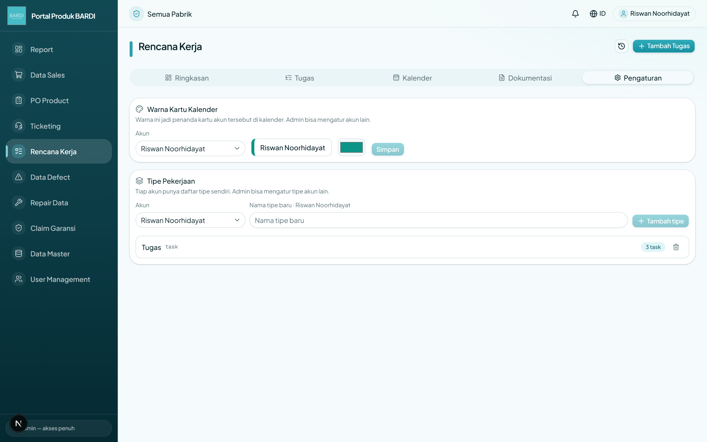
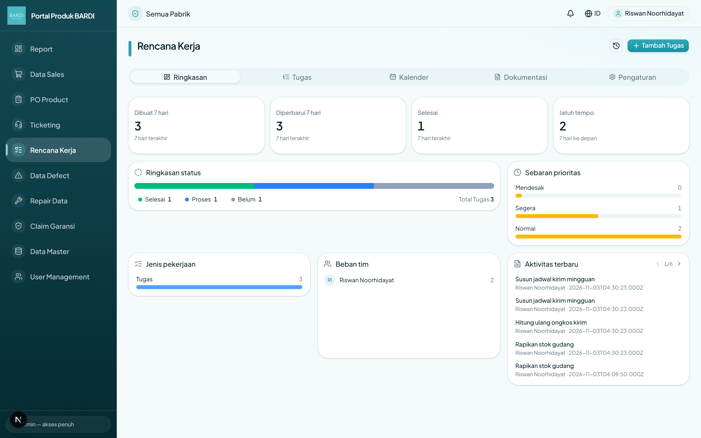
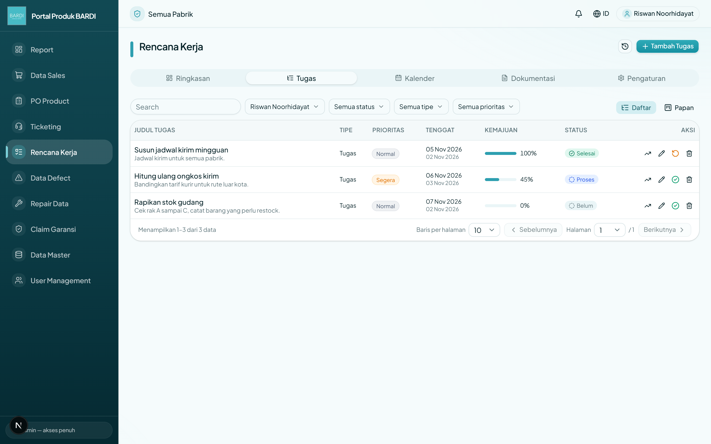
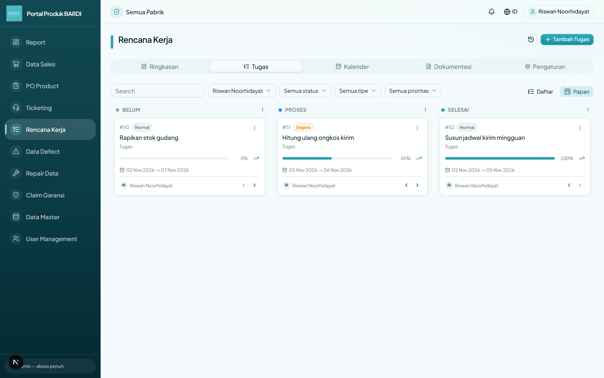
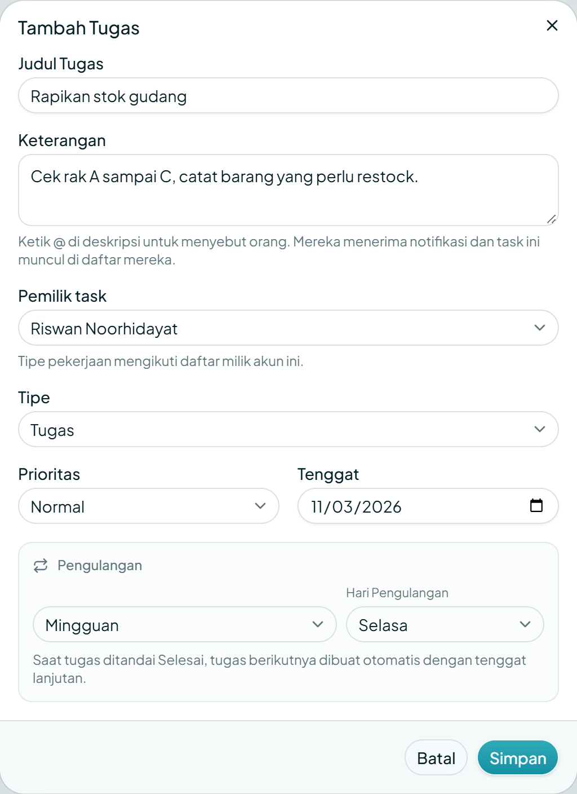
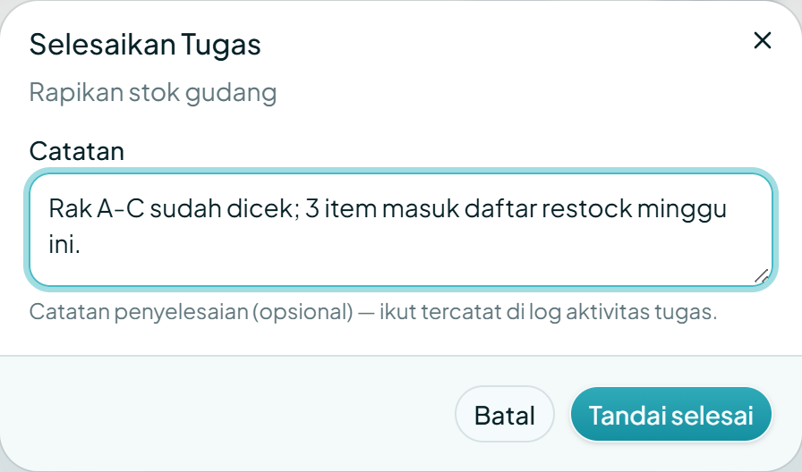
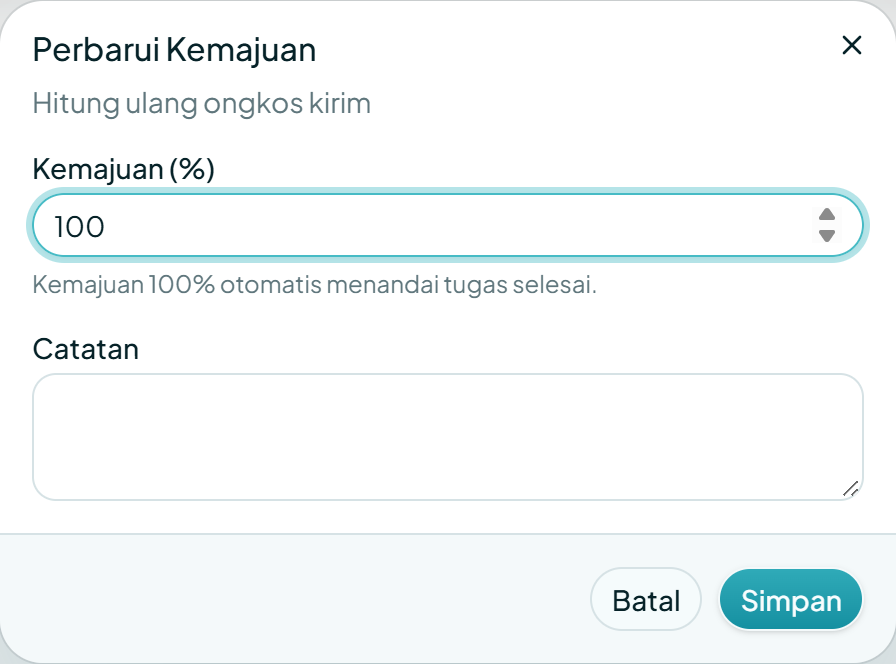
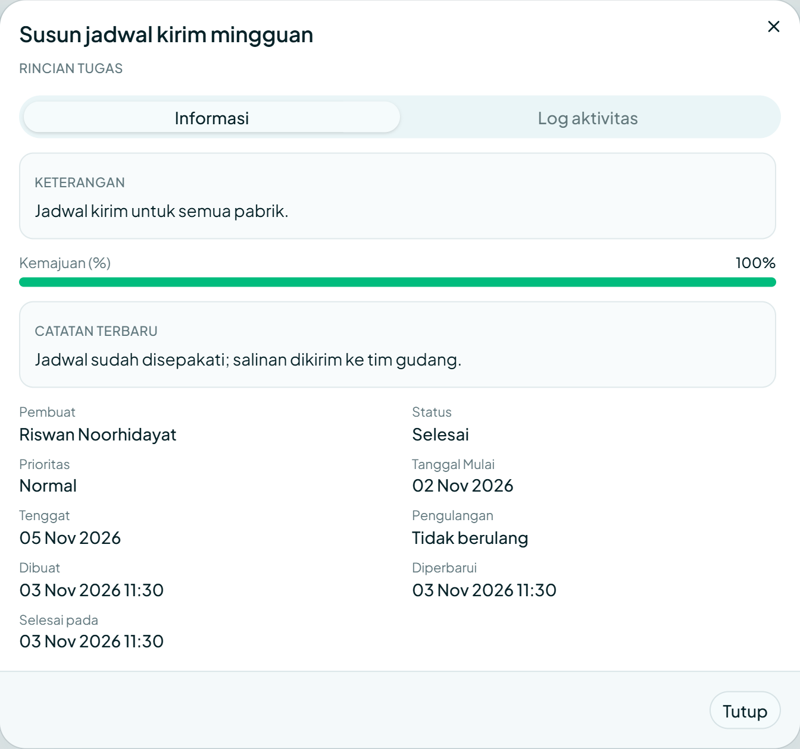
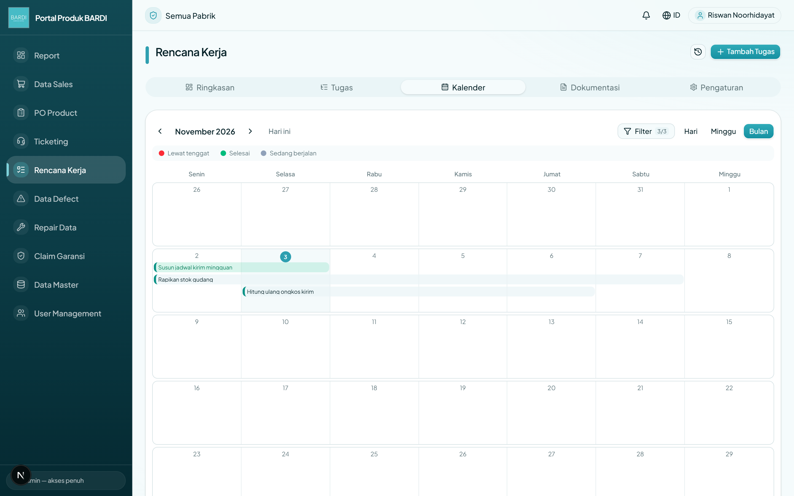
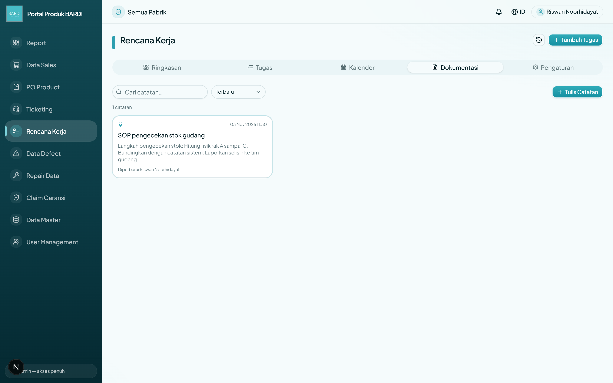

# Panduan Lengkap Rencana Kerja

Panduan ini menjelaskan **semua** yang bisa dilakukan di menu **Rencana Kerja** (Task Planner), dari menyiapkan pengaturan sampai menyelesaikan tugas sehari-hari. Ditulis langkah demi langkah dengan bahasa sederhana, jadi bisa diikuti siapa pun tanpa pelatihan khusus.

Ada dua hal yang perlu diingat sejak awal:

- **Tab Pengaturan wajib diisi dulu** oleh setiap akun. Tanpa itu, daftar Tipe masih kosong dan form tugas akan menampilkan pesan "Belum ada tipe".
- **Setiap akun punya daftar tipe sendiri.** Admin bisa mengatur tipe dan warna akun lain.

> Panduan ini dibuat untuk tampilan aplikasi versi 3 November 2026.

## 1. Peta halaman Rencana Kerja

Menu Rencana Kerja punya lima tab. Semuanya terbuka lewat menu di sebelah kiri.

| Tab | Isinya |
| --- | --- |
| Ringkasan | Angka ringkas, sebaran status/prioritas/tipe, beban tim, aktivitas terbaru |
| Tugas | Daftar dan papan seluruh tugas, lengkap dengan filter dan pencarian |
| Kalender | Batang tugas per tanggal dalam tampilan Hari, Minggu, atau Bulan |
| Dokumentasi | Catatan bersama dengan editor teks dan sebutan `@` |
| Pengaturan | Warna kartu kalender dan daftar tipe pekerjaan |

Di pojok kanan atas ada dua tombol yang selalu tersedia:

- **Ikon riwayat** — membuka daftar seluruh aktivitas tugas: siapa melakukan apa dan kapan.
- **Tambah Tugas** — membuat tugas baru. Tombol ini hanya muncul bila akun punya izin menulis di menu Rencana Kerja.

## 2. Wajib dulu: atur tab Pengaturan

Lakukan dua hal ini **sebelum** membuat tugas pertama. Tab Pengaturan terbuka untuk semua akun, bukan hanya admin.

### 2.1 Pilih warna kartu kalender

1. Buka **Rencana Kerja**, lalu klik tab **Pengaturan**.
2. Arahkan kursor ke kartu **Warna Kartu Kalender**.
3. Pada kolom **Akun**, pastikan nama Anda yang dipilih.
4. Klik **Warna kalender**, lalu pilih warna.
5. Klik **Simpan**.

Warna ini menjadi penanda kartu dan batang tugas milik akun tersebut di tab **Kalender**. Jadi di kalender ramai, Anda tidak perlu membaca nama pemilik satu per satu — cukup lihat warnanya. Admin bisa memilih akun lain pada dropdown **Akun** untuk mengatur warna anggota tim.

### 2.2 Buat daftar tipe pekerjaan

Aplikasi **tidak** menyediakan tipe bawaan. Setiap akun mulai dengan daftar kosong.

1. Di tab **Pengaturan**, lihat kartu **Tipe Pekerjaan**.
2. Ketik nama tipe pada kolom **Nama tipe baru**, misalnya `Tugas`, `Bug`, `Fitur`, atau `Sub-task`.
3. Klik **Tambah tipe**.
4. Ulangi untuk semua tipe yang biasa Anda pakai.

Beberapa hal penting:

- Tipe disimpan **per akun**. Daftar yang muncul di form tugas adalah milik **pemilik tugas** yang sedang dipilih, bukan milik pembuat form.
- Bila daftar tipe masih kosong, form tugas menampilkan pesan **"Belum ada tipe — tambah di tab Pengaturan."**
- Tipe yang sudah dipakai tidak bisa dihapus. Muncul pesan **"Tipe masih dipakai (jumlah) task, tidak bisa dihapus."**
- Admin dapat memilih akun lain pada dropdown **Akun** untuk merapikan tipe anggota timnya.

> **Kenapa wajib?** Tanpa tipe, tugas tetap bisa disimpan dengan kode tipe dasar `task`. Tetapi filter **Tipe** di tab Tugas dan grafik **Jenis pekerjaan** di tab Ringkasan jadi tidak berguna karena semua tugas masuk satu kelompok.

## 3. Tab Ringkasan

Tab Ringkasan adalah dasbor singkat. Isinya:

1. **Empat kartu angka** (masing-masing bisa diklik):
   - **Dibuat 7 hari** — tugas yang dibuat dalam 7 hari terakhir.
   - **Diperbarui 7 hari** — tugas yang diubah dalam 7 hari terakhir.
   - **Selesai** — semua tugas berstatus Selesai.
   - **Jatuh tempo** — tugas belum selesai yang tenggatnya dalam 7 hari ke depan.
   Klik salah satu kartu: halaman pindah ke tab **Tugas** dengan filter cepat yang sesuai.
2. **Ringkasan status** — jumlah Belum, Proses, Selesai beserta legenda, warna, dan tombol **Hapus filter kartu**.
3. **Sebaran prioritas** — jumlah tugas per prioritas (Mendesak, Segera, Normal). Klik batangnya untuk memfilter.
4. **Jenis pekerjaan** — jumlah tugas per tipe. Tipe yang sama dari akun berbeda digabung menjadi satu baris.
5. **Beban tim** — jumlah tugas **belum selesai** per anggota. Tugas yang sudah selesai tidak dihitung agar beban terlihat nyata.
6. **Aktivitas terbaru** — daftar perubahan terakhir. Klik satu baris untuk membuka **Rincian Tugas**.

## 4. Tab Tugas: Daftar dan Papan

Tab Tugas menyajikan data yang sama dalam dua tampilan. Pilihan tampilan tersimpan di profil Anda, jadi saat membuka lagi akan kembali seperti terakhir dipakai.

### 4.1 Siapa melihat tugas apa

- **Admin** melihat seluruh tugas semua akun.
- **Akun biasa** melihat tugas miliknya sendiri **dan** tugas yang menyebut dirinya dengan `@`.
- Tugas yang menyebut Anda tetap muncul walaupun bukan milik Anda. Di tabel ada tanda **Di-@** di samping judul, dan kolom Pemilik ikut ditampilkan supaya jelas.

### 4.2 Tampilan Daftar

- **Kotak cari** — mencari judul dan keterangan tugas.
- **Filter** — Pemilik (khusus admin), Status, Tipe, Prioritas. Bisa dipilih lebih dari satu nilai.
- **Pelaku** di kanan atas — berpindah antara **Daftar** dan **Papan**.
- **Kolom** — Judul, Tipe, Prioritas, Tenggat (dengan tanggal mulai kecil di bawahnya), Kemajuan, Status, dan Aksi.
- **Aksi per baris**:
  - **Grafik naik** — membuka dialog *Perbarui Kemajuan*.
  - **Pensil** — mengubah tugas.
  - **Centang** — menandai selesai (atau membuka lagi bila sudah selesai).
  - **Tempat sampah** — menghapus tugas.
- **Baris arsip** — tugas selesai lebih dari 7 hari otomatis disembunyikan dari daftar utama. Pilih filter Status **Arsip** untuk melihatnya. Tugas arsip tetap tampil di Kalender dan Ringkasan.

### 4.3 Tampilan Papan

Papan punya tiga kolom tetap: **Belum**, **Proses**, dan **Selesai**. Setiap kartu bisa digeser ke kolom lain:

- **Geser kartu** ke kolom tujuan, lalu lepas. Status tugas langsung berubah.
- Bila kartu digeser ke kolom **Selesai**, dialog catatan penyelesaian muncul lebih dulu (lihat bagian 6).
- Bila perangkat tidak mendukung geser-lepas, gunakan tombol **panah kiri/kanan** di kartu sebagai alternatif.
- Tombol **titik tiga** membuka menu Ubah dan Hapus.

## 5. Membuat tugas baru

Klik **Tambah Tugas** di kanan atas. Form yang muncul berisi tujuh isian; sisanya diisi otomatis oleh server.

| Isian | Wajib? | Keterangan |
| --- | --- | --- |
| Judul Tugas | Wajib | Nama singkat pekerjaan |
| Keterangan | Opsional | Penjelasan, boleh menyebut orang dengan `@` |
| Pemilik task | Otomatis | Terisi Anda; admin bisa memilih akun lain |
| Tipe | Opsional | Diambil dari daftar tipe milik pemilik tugas |
| Prioritas | Otomatis | Normal, Segera, atau Mendesak |
| Tenggat | Opsional | Tanggal batas; tidak boleh sebelum tanggal mulai |
| Pengulangan | Otomatis | Tidak berulang, Harian, Mingguan, atau Bulanan |

Nilai yang tidak diisi akan memakai default server: **tanggal mulai hari ini**, status **Belum**, dan kemajuan **0%**. Karena itu tanggal mulai tidak perlu diisi di form.

### 5.1 Pengulangan

Kartu **Pengulangan** kini selebar form supaya isiannya tidak menggantung di setengah kolom.

| Pilihan | Isian tambahan yang muncul |
| --- | --- |
| Tidak berulang | Tidak ada — tugas berhenti setelah selesai |
| Harian | Tidak ada — tugas berikutnya dibuat setiap hari |
| Mingguan | **Hari Pengulangan** (Senin–Minggu) |
| Bulanan | **Tanggal Pengulangan** (1–31) |

Saat tugas berulang ditandai selesai, sistem **otomatis** membuat tugas berikutnya dengan tenggat tanggal lanjutan. Tugas baru memakai orang yang sama dan menyebut siapa pun yang di-`@`, tetapi **tidak** mengirim notifikasi ulang.

### 5.2 Menyebut orang dengan @

Ketik `@` di kolom **Keterangan**, lalu pilih nama. Sebutan yang sudah cocok dengan akun akan **disorot** di atas kolom, jadi Anda tahu sebutan itu berhasil.

Orang yang disebut akan:

- menerima notifikasi di lonceng,
- melihat tugas itu di daftar tugasnya (dengan tanda **Di-@**),
- boleh mengubah tugas tersebut.

Daftar nama pada popup `@` hanya menampilkan **nama akun**, bukan username.

## 6. Menyelesaikan tugas (empat cara)

Semua cara di bawah berakhir sama: status berubah menjadi **Selesai**, kemajuan menjadi **100%**, dan **catatan penyelesaian** bisa ditambahkan.

| Cara | Di mana | Yang terjadi |
| --- | --- | --- |
| Ikon centang | Kolom **Aksi** pada tab Tugas tampilan Daftar | Dialog **Selesaikan Tugas** terbuka |
| Geser kartu | Tab Tugas tampilan **Papan** | Seret kartu ke kolom **Selesai**, lalu isi catatan |
| Panah → | Kartu pada tampilan Papan | Pindah status bertahap; saat masuk kolom Selesai, dialog catatan terbuka |
| Kemajuan 100% | Ikon grafik pada baris tugas (dialog **Perbarui Kemajuan**) | Angka 100 memicu petunjuk "otomatis menandai tugas selesai" |

### 6.1 Dialog Selesaikan Tugas

- Kolom **Catatan** bersifat **opsional**. Boleh dikosongkan.
- Tombol **Tandai selesai** **tidak menunggu** catatan diisi.
- Catatan yang diisi akan tersimpan sebagai bagian dari log aktivitas tugas, bukan mengubah keterangan tugas.

> **Membuka tugas lagi:** klik ikon centang sekali lagi. Status kembali ke **Belum** dan tugas dibuka tanpa membuka dialog, karena tidak ada yang perlu dicatat saat membatalkan.

### 6.2 Menyelesaikan lewat Kemajuan 100%

Buka dialog **Perbarui Kemajuan** dari ikon grafik, isi `100`, lalu simpan. Aplikasi menampilkan petunjuk *"Kemajuan 100% otomatis menandai tugas selesai"* dan status langsung berubah menjadi Selesai beserta catatannya.

Bila Anda mengisi angka 100 **tanpa** catatan, tugas tetap selesai — catatan hanya membantu orang lain memahami hasil akhirnya. Angka di atas 99 tapi di bawah 100 akan disimpan sebagai 99% agar tugas tidak selesai tanpa sengaja.

## 7. Rincian tugas

Klik judul tugas di tampilan Daftar, atau klik kartu di Papan, untuk membuka **Rincian Tugas**.

- Tab **Informasi** memuat keterangan, kemajuan, **catatan terbaru**, pembuat, status, prioritas, tanggal mulai, tenggat, pengulangan, waktu dibuat/diperbarui, dan waktu selesai.
- Tab **Log aktivitas** memuat riwayat perubahan, termasuk semua catatan penyelesaian.
- Tombol **Ubah** dan **Hapus** hanya muncul bila akun punya izin menulis. Pembaca tetap bisa membuka rincian dan melihat log.

## 8. Tab Kalender

- Pilih tampilan **Hari**, **Minggu**, atau **Bulan**.
- **Filter** membuka pilihan anggota yang ditampilkan. Tombol **Tampilkan semua pengguna** menampilkan seluruh tim sekaligus.
- **Legenda** menjelaskan warna: merah lewat tenggat, hijau selesai, abu-abu sedang berjalan.
- **Batang tugas** digambar dari tanggal mulai sampai tenggat. Bila tugas diselesaikan lebih awal, batangnya **berhenti di tanggal selesai** — sisa waktunya tidak lagi terpakai. Arahkan kursor ke batang untuk melihat keterangan *Selesai pada …*.
- Klik tanda **+jumlah** di sebuah tanggal untuk membuka tampilan Hari pada tanggal itu.
- Klik batang tugas untuk membuka Rincian Tugas.

## 9. Tab Dokumentasi

Tab Dokumentasi menyimpan catatan bersama tim, misalnya SOP atau hasil rapat.

- **Cari catatan** dan urutkan berdasarkan **Terbaru** atau **Judul**.
- **Tulis Catatan** membuka editor. Isi judul, lalu tulis di editor: tebal, miring, garis bawah, coret, warna, perataan, daftar, indentasi, kutipan, tautan, dan `@` untuk menyebut orang atau tugas.
- **Sematkan** membuat catatan selalu muncul paling atas.
- **Ubah** dan **Hapus** tersedia sesuai izin.
- Menyebut orang dengan `@` di catatan mengirim notifikasi, sama seperti di tugas.

## 10. Notifikasi dan riwayat

- **Lonceng** di header menampilkan notifikasi: sebutan `@`, tugas yang menyebut Anda, dan perubahan terkait. Angka merah menunjukkan yang belum dibaca.
- **Ikon riwayat** di halaman Rencana Kerja membuka dialog seluruh aktivitas tugas: siapa, melakukan apa, kapan, dan catatannya.

## 11. Hak akses dan peran

- Izin diatur per menu: **baca** dan **tulis**. Bila akun punya izin tulis di Rencana Kerja, tombol Tambah, Ubah, Hapus, dan geser kartu muncul.
- **Admin** melihat dan mengubah semua tugas, termasuk milik akun lain.
- **Akun biasa** mengurus tugasnya sendiri dan tugas yang menyebut dirinya.
- **Hapus tugas** hanya untuk pembuat tugas dan admin.
- Bila sebuah tombol tidak muncul, kemungkinan akun tidak punya izin tulis di menu tersebut — bukan karena aplikasi rusak.

## 12. Alur kerja harian yang disarankan

1. **Pagi** — buka tab Ringkasan, lihat kartu **Jatuh tempo** dan **Beban tim**.
2. **Menambah pekerjaan** — klik Tambah Tugas, isi judul dan tenggat, pilih tipe. Sertakan `@` bila pekerjaan perlu bantuan orang lain.
3. **Sepanjang hari** — pindahkan kartu di Papan (Belum → Proses → Selesai) atau perbarui kemajuan lewat ikon grafik.
4. **Saat selesai** — tulis catatan penyelesaian: apa hasilnya, apa yang tersisa, atau tautan bukti.
5. **Sore** — cek lonceng, lalu tab Kalender untuk melihat beban beberapa hari ke depan.
6. **Akhir minggu** — buka Ringkasan, lihat **Selesai** dan **Jenis pekerjaan** untuk mengevaluasi.

## 13. Pertanyaan yang sering muncul

**Tugas saya tidak muncul di daftar, padahal orang lain menyebut saya.**
Coba muat ulang halaman. Bila tetap tidak ada, periksa filter Pemilik: pastikan tidak sedang memfilter akun lain. Tugas yang menyebut Anda selalu punya tanda **Di-@**.

**Kenapa tombol Tambah Tugas tidak ada?**
Akun Anda tidak punya izin tulis di menu Rencana Kerja. Hubungi admin untuk mengatur izin role.

**Kenapa daftar Tipe kosong?**
Setiap akun punya daftar tipe sendiri dan tidak ada tipe bawaan. Tambahkan di tab Pengaturan (bagian 2.2).

**Apakah catatan penyelesaian wajib?**
Tidak. Dialog bisa disimpan tanpa catatan; tombol Tandai selesai hanya nonaktif ketika proses simpan sedang berjalan.

**Kartu tidak mau berpindah saat digeser.**
Pastikan Anda menggeser kartu, bukan tombol di dalamnya. Bila perangkat tidak mendukung, gunakan tombol panah kiri/kanan pada kartu.

**Tugas yang selesai hilang dari daftar.**
Tugas tetap ada. Setelah 7 hari, tugas selesai masuk arsip; pilih filter Status **Arsip** untuk melihatnya.

**Bisakah catatan penyelesaian diubah?**
Catatan adalah bagian log aktivitas dan tidak bisa disunting. Untuk koreksi, tulis catatan baru lewat dialog kemajuan atau tulis hasilnya di Dokumentasi.

**Apakah tugas berulang membuat notifikasi baru untuk orang yang di-@?**
Tidak. Tugas lanjutan mewarisi sebutan tanpa mengirim notifikasi ulang.

## 14. Lampiran: istilah yang dipakai

| Istilah | Artinya |
| --- | --- |
| Tugas | Satu pekerjaan dengan judul, pemilik, status, dan tenggat |
| Tipe | Label pekerjaan milik satu akun, misalnya `Tugas`, `Bug`, `Fitur` |
| Prioritas | Tingkat kepentingan: Mendesak, Segera, atau Normal |
| Tenggat | Tanggal batas penyelesaian |
| Tanggal mulai | Tanggal tugas mulai dihitung; diisi otomatis hari ini |
| Kemajuan | Persentase pekerjaan; 100% berarti selesai |
| Pengulangan | Aturan pembuatan tugas berikutnya secara otomatis |
| Arsip | Kumpulan tugas selesai yang lebih tua dari 7 hari |
| Di-@ | Sebutan yang menghubungkan tugas dengan akun tertentu |
| Role | Kelompok izin yang menentukan menu dan aksi yang boleh dipakai |

---

Panduan ini akan diperbarui bila tampilan aplikasi berubah. Dokumen ini menggantikan panduan singkat *PANDUAN-task-selesai-catatan* yang terbit sebelumnya.
